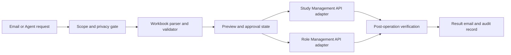

# Clinical Study Access Automation Agent

A source-available portfolio project demonstrating how email requests and spreadsheet applications can be converted into auditable account and role-management workflows for clinical-study systems.

> Portfolio boundary: this repository contains fictional demonstration data and generic API contracts only. It does not contain production credentials, customer records, mailboxes, databases, logs, internal endpoints, or live service configuration.

## What it does

- receives account requests from email or local `.eml` files;
- validates spreadsheet structure and row-level required fields;
- classifies create, update and disable operations;
- prepares preview and approval records before any write operation;
- calls a generic Study Management API and Role Management API;
- verifies per-user outcomes instead of treating process exit as business success;
- sends result notifications while preserving an auditable job state;
- applies a strict scope gate before exposing tools through an Agent channel.

This project automates administrative access workflows. It is not a clinical decision system, medical device, patient-matching tool, or source of medical advice.

## Architecture



## Repository layout

| Path | Purpose |
| --- | --- |
| `scripts/email_intake.py` | IMAP/SMTP intake, attachment policy, workflow state, approvals and result delivery |
| `scripts/setup_study_from_excel.py` | workbook parsing, validation and Study API operations |
| `scripts/setup_role_assignments_from_excel.py` | Role API lookup, assignment, update and verification |
| `scripts/manual_user_change_to_excel.py` | converts a structured manual request into a compatible workbook |
| `tests/self_test.py` | deterministic tests using temporary files and mocked API responses |
| `assets/application-template.xlsx` | fictional public demonstration template |
| `integrations/hermes/` | author-written Hermes integration patch, separated from third-party source |
| `ops/gateway_monitor.py` | optional macOS `launchd` watchdog reference used by the original deployment |

## Technology stack

- Python 3.11+
- standard-library IMAP, SMTP, email, JSON, subprocess and HTTP clients
- `openpyxl` with a standard-library XLSX fallback
- `PyYAML`
- `pypinyin`
- Hermes Agent integration and DingTalk adapter patching
- GitHub Actions, CodeQL and Gitleaks

## Quick start

```bash
python -m venv .venv
```

Activate the environment, then install dependencies:

```bash
python -m pip install -r requirements.txt
```

Copy the example configuration and fill only development values:

```bash
cp .env.example .env
```

Do not commit `.env`.

### Parse a fictional workbook without changing a service

```bash
python scripts/setup_study_from_excel.py \
  --excel-file assets/application-template.xlsx \
  --project-id DEMO001 \
  --parse-only
```

### Run the deterministic self-test

```bash
python tests/self_test.py
```

### Validation snapshot

The portfolio preparation run on 2026-09-01 completed the dependency check,
Ruff high-severity checks, Python compilation, 30 deterministic test functions
with 235 passing checks, fictional workbook parse-only validation, structured
asset parsing and a full public-tree sensitive-information scan. The local run
used Windows and Python 3.9.13; the declared Python 3.11 and 3.12 matrix remains
to be confirmed by GitHub Actions after publication.

### Email intake in local preview mode

```bash
python scripts/email_intake.py \
  --eml-file /path/to/fictional-request.eml \
  --mode preview \
  --work-dir .runtime/jobs
```

Live API or mailbox operations require separately supplied development credentials and explicit confirmation flags. No working endpoint or credential is included here.

## Safety boundaries

- preview and validation should precede every mutation;
- tool access is controlled by explicit business routes, not an unrestricted model decision;
- unsupported attachments and out-of-scope requests are rejected before execution;
- duplicate mail and attachment fingerprints can be recorded to prevent replay;
- partial user failures must produce a failed or partial result, never a blanket success;
- secrets belong in environment variables or a secret manager;
- production mail, study, site and user data must never be used as public fixtures.

See [Security](SECURITY.md), [Privacy](docs/PRIVACY.md), [Architecture](docs/ARCHITECTURE.md) and [Testing](docs/TESTING.md).

## Demonstration data

All committed studies, sites, users, addresses, phone numbers and email addresses are fictional. Reserved domains such as `example.test` and `example.invalid` are used deliberately. The repository does not include a database or recorded production messages.

## Third-party boundary

Hermes is a third-party MIT-licensed project. This repository does not vendor the Hermes codebase. It includes only an author-written patch reference against the version documented in [THIRD_PARTY_NOTICES.md](THIRD_PARTY_NOTICES.md).

## License

The author-written material is released under the [Portfolio Source-Available License 1.0](LICENSE). Third-party components retain their own licenses.
